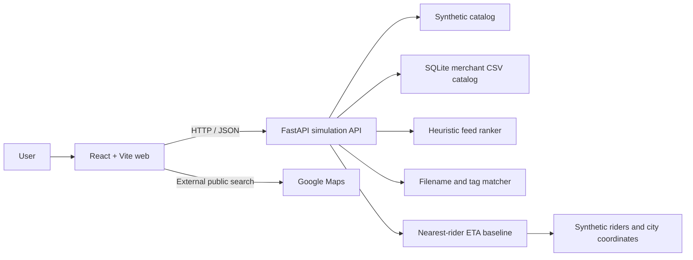
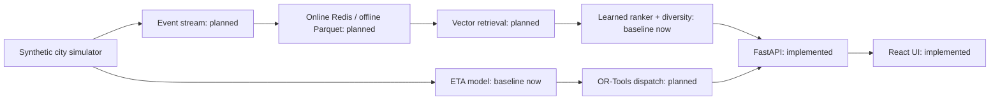

  RET --> RANK[Heuristic ranker + diversity: implemented]
# Architecture and Trade-offs

## Implemented now

`docker compose up --build` runs the web and API independently. Synthetic catalog and rider data are deterministic Python fixtures. Authorized merchant CSV rows are upserted into a persistent SQLite catalog keyed by merchant and SKU; Compose mounts `api/data` for persistence. The Maps link opens a public search externally and does not copy listing content into this database.

Merchant imports require `MERCHANT_IMPORT_TOKEN`, accept UTF-8 CSV up to 2 MB / 5,000 rows, validate the eight supported categories, and record an `inventory_updated_at` timestamp. Re-uploading the same merchant/SKU updates that row. This is manual ingestion, not a POS/webhook integration. Imported inventory has no simulated ETA and is excluded from synthetic checkout.

## Intended tiers

The second diagram is a target, not a claim that those infrastructure components exist. Kafka/Redpanda, Redis, Parquet, vector search, learned models, and OR-Tools are not wired into this starter. The implemented feed uses fixed synthetic interest weights and category diversity, with a selectable popularity-only comparison baseline.

## Design notes

### Retrieve then rank

At scale, retrieval should cheaply produce a candidate set and a ranker should apply richer user, item, inventory, and delivery features to those candidates. The current catalog is small enough to scan directly, so this project uses it as a clear baseline rather than simulating a distributed retrieval stack without real scale.

### Approximate versus exact nearest neighbors

The current visual matcher is lexical and exact over synthetic tags; there is no embedding index yet. A future vector-search experiment should report recall against exact nearest-neighbor results alongside p95 latency, index size, and refresh cost before selecting Qdrant or FAISS.

### Training and serving skew

There is no model training or feature store in the implemented slice. If models are added, define shared feature transformations and log point-in-time feature snapshots so offline training and online inference compute matching values. Redis/Parquet are a possible serving/archive split, not current project dependencies.

### Optimizer plus predicted costs versus pure RL

The dispatch baseline currently chooses the closest available rider and computes a transparent ETA. A next step is to use predicted travel/prep costs in a constrained OR-Tools assignment problem; explicit constraints are easier to inspect and compare against a baseline than a pure-RL policy in a small synthetic environment. No optimizer or learned ETA model is included yet.

## Baselines and results

No performance metrics are published yet. Before claiming improvement, add reproducible fixed-seed evaluation and compare:

| Module | Baseline | Metric to report |
| --- | --- | --- |
| Feed | Popularity-only order | NDCG@10, plus category coverage |
| Visual retrieval | Exact lexical scan | Recall@10 and p95 latency |
| ETA | Mean prep time + straight-line travel at fixed speed | MAE in minutes |
| Dispatch | Nearest rider | Mean delivery time and rider idle share |

All future metrics describe the simulation only. They are not real-world performance claims.

## Scale questions

- Embedding refresh and deletion when a synthetic catalog changes.
- Stale inventory and the cost of confirming availability with local stores.
- Hot-key pressure on a shared feature store during peak periods.
- Dispatch solve time and constraint quality as synthetic order volume grows.
- Cold-start behavior for newly generated users and merchants.

## Public references

These are background reading, not private or proprietary source data:

- [PinSage paper](https://arxiv.org/abs/1806.01973): graph-based item embeddings and large-scale recommendation retrieval.
- [PinnerSage paper](https://arxiv.org/abs/2007.03634): representing users with multiple interests rather than a single embedding.
- [Pinterest Engineering](https://medium.com/pinterest-engineering): production engineering context for recommendation and visual discovery systems.
- [Swiggy Bytes](https://bytes.swiggy.com/): public engineering posts for delivery and marketplace systems.
- [Zomato Blog](https://www.zomato.com/blog): public company posts; verify specific engineering posts before citing them as technical evidence.
- [Myntra Engineering on Medium](https://medium.com/myntra-engineering): public engineering articles for fashion commerce systems.